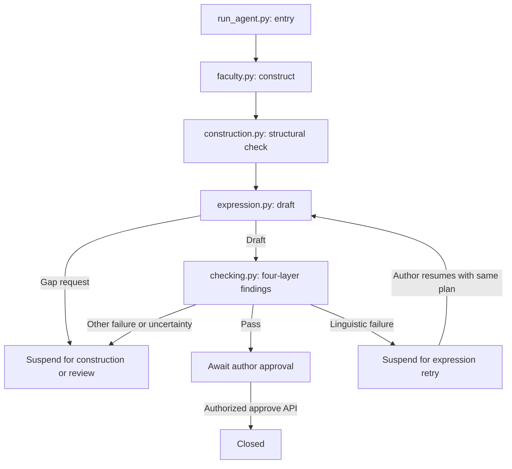

# Authorial Agent code structure — 27 November 2026

## Scope

This public record covers runtime source files, code interfaces, the author's code-only execution instruction and synthetic verification. Detailed workbook-derived audit records are excluded.

Source snapshot: `f539b96f598b5cb75548eca069a75f28bb8ef680`.
Archived source snapshot: `93480bed885c813e127a7749606a91f435b84be4`.

The current source tree contains 14 production Python modules and 14 test modules. The latest archived software package's 34 files match the 34 current `src/` files. No production code was changed by this inspection.

## Current instruction

`decisions/code-only-loop-execution-v0.1.json` records the author's instruction to execute the authorial procedure only through code, place each loop in its own owning file, and keep the procedure and state inspectable. `AGENTS.md` carries this instruction for subsequent work.

This is a recorded requirement. It is not a claim that the existing implementation already satisfies it.

## Four layers and execution order

| Layer | Required role | Current code |
|---|---|---|
| Conceptual | Construct definitions, distinctions and relationships. | General construction plus a conceptual checker finding; no dedicated pre-expression closure. |
| Epistemic | Construct claims, warrants, evidence, qualifications, objections and dependencies. | Claims and evidence references exist; the provider schema omits explicit warrants and claim dependencies. |
| Rhetorical | Establish purpose/order of intellectual acts, then realize them. | Ordered acts with purpose and sentence mappings exist. Separate composition hierarchy is incomplete. |
| Linguistic | Realize acts through resolved rules and authentic exemplars; repair diagnosed defects. | Rule records reach the writer; grounding passages are not expanded into the context. |

Construction precedes expression. Rhetorical purpose/order is planned during construction; rhetorical realization and linguistic expression follow. Checking covers all four layers. Four layers do not mean four independent sequential model calls.

## Actual runtime

`run_agent.main` composes `Execution`, `Faculty`, `Expression` and `Checking`.

A normal attempt invokes the model through three methods: `JSONModel.propose`, `JSONModel.realize` and `JSONModel.assess`.



The construction plan is stored as `proposed_unvalidated`. The expression code checks graph structure but does not require a closed conceptual/epistemic construction state.

## Module map

| File | Actual responsibility |
|---|---|
| `src/model.py` | SQLite graph, typed API relations, revisions and dependency invalidation. |
| `src/ingest.py` | Workbook input adapter and candidate provenance. |
| `src/faculty.py` | Construction provider context, proposed claims/acts and atomic graph persistence. |
| `src/construction.py` | Structural gate for intent, provenance, acts, stale inputs and cycles. |
| `src/expression.py` | Writer context, coverage/order/sentence-reference checks and reopen requests. |
| `src/checking.py` | Four revision-bound findings and reopening tickets. |
| `src/execution.py` | Bounded attempt coordinator, persistent state, routing and approval API. |
| `src/providers.py` | HTTP model adapter with hardcoded role prompts and response schemas. |
| `src/research.py` | Retrieval provider. |
| `src/governance.py` | Bilateral retrieval and a separate evidence-assessment helper. |
| `src/learning.py` | Teaching, feedback, author-governed rule proposals and version snapshots. |
| `src/coverage.py` | Coverage inventory and teaching objectives. |
| `src/run_agent.py` | CLI and component composition. |
| `src/evaluate.py` | Development-case preparation and optional invocation of the CLI. |

A module is not automatically a complete loop. Research functions span several files; no distinct composition-loop or targeted editing-loop owner exists. `loops/inventory-v0.1.json` records current ownership, inputs, outputs, closure behavior and gaps.

## Confirmed gaps from source inspection

1. No production module loads `procedures/v*.json` or `loops/design-contract.json`. The CLI has no procedure selector.
2. Expression can begin with construction still marked `proposed_unvalidated`.
3. The construction provider schema does not produce explicit warrants, rebuttal links or claim-level dependencies.
4. Rule grounding references are not expanded into exemplar passages supplied to the writer. No production code reads the written reference file.
5. Rule selection queries all non-stale rule nodes rather than a single frozen imported digest.
6. Approved learning snapshots are not read by the generation pipeline.
7. Expression retries receive the same plan without the previous draft or diagnosed findings.
8. Construction repair is explicitly not automated.
9. Neither current nor archived Python source implements the platform's canonical-loop interface. DS-09.01 requires adapting it and prohibits silently introducing a parallel lifecycle.
10. The adapter does not preserve a complete replay record of exact requests, full responses and procedure/model/commit/input binding.
11. The research sufficiency helper is not called by the main pipeline.
12. No executable paragraph-by-paragraph loop is present.

These are code-level observations. They do not identify the cause of any detector result.

## Verification

From the pinned `src/` directory:

```text
python -m unittest discover -v
```

**38 tests passed.** The tests use fixtures and mocked transports. They verify structural gates, graph persistence and staleness, expression order/coverage, routing, trusted-actor authorization, retry limits, ingestion, learning and integration.

A synthetic connectivity probe additionally observed a writer invocation while the plan remained `proposed_unvalidated`, absence of imported exemplar nodes from its context, and transition to `awaiting_approval` after fixture checks. No live provider call or author approval was performed.

The test log and execution metadata are in `verification/`.

## Next implementation work

Complete the existing architecture in this order:

1. Resolve the common canonical-loop interface and assign one owning file per loop.
2. Bind the actual runtime to procedure/configuration/input revisions and preserve exact provider exchanges.
3. Complete and gate conceptual/epistemic construction.
4. Resolve rules and their relevant grounding passages into model inputs.
5. Connect diagnosed findings to targeted expression and intellectual repair.
6. Implement the paragraph loop with the same lifecycle, then distinguish fixture verification from controlled live evaluation.

The production writing engine and historical procedures remain unchanged by this audit.
