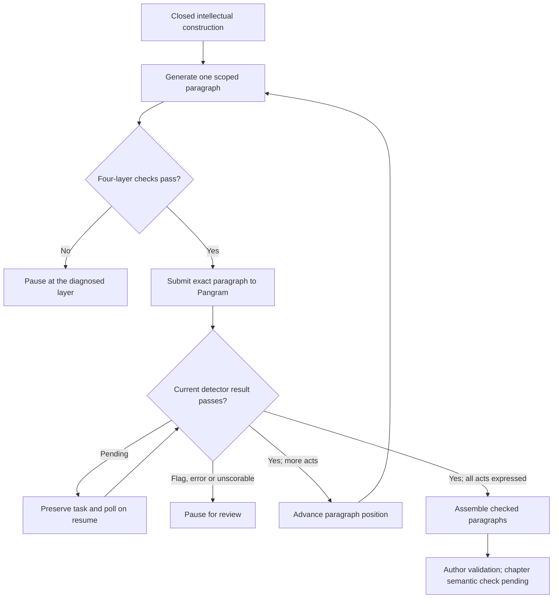

# Paragraph Pangram gate v0.1

Status: author-directed timing change implemented through code; fixture evidence only; live validation pending.

Implementation baseline: `68d26bda0effa4e17a33c6c3ac3aca6141c93be5`.

The author asked to place Pangram at the end of each paragraph generation so a failed result would stop the work before an entire document was generated. [The procedure addendum](../procedures/addenda/paragraph-pangram-v0.1.json) records this instruction. It supplements the separately selected base procedure. Earlier procedure files, voice rules, ledgers, loop maps and run records remain intact.

## Execution order

The existing `Execution` remains the coordinator. `ParagraphLoop` owns paragraph progression and returns explicit checkpoints to it. `PangramCheck` owns the detector observation. These additions do not claim integration with the external platform's canonical-loop interface.

Construction still precedes expression. Conceptual and epistemic work, together with rhetorical act purpose/order, is reviewed and explicitly closed before any paragraph is generated. The paragraph writer receives the closed structure, its scoped acts, the same selected rules and authentic exemplars, and the exact preceding accepted paragraphs as continuity context. It does not generate a whole chapter and split it afterward.

Four-layer checking evaluates the paragraph before detector submission. Existing diagnosed linguistic failures can enter the explicit editing path, which receives the earlier draft and actual findings. Epistemic/rhetorical-construction defects, conceptual issues and uncertain findings retain their existing routes. Pangram flags do not automatically create an editing attempt or enter an expression prompt.

## Gate and stop conditions

The configured `all-human-v1` policy requires zero AI and AI-assisted fractions, no AI/AI-assisted segment counts, and every returned window labeled `Human Written`. The adapter also validates the exact returned text, complete window coverage, confidence fields, internally consistent fractions/counts and the explicitly expected detector version.

| Condition | Recorded behavior |
| --- | --- |
| Four-layer assessment is unresolved | Pause before Pangram submission and before the next paragraph. |
| Detector task is pending | Retain the task ID; a later resume polls that task without generating another paragraph. |
| Current four-layer and detector checks pass | Record the accepted paragraph and permit the next paragraph. |
| AI-generated or AI-assisted content is reported | Pause for review; preserve the paragraph and detector observation. |
| Paragraph has fewer than the configured minimum words | Record `unscorable`; do not pad or combine text. |
| Credential/configuration is missing or changed | Block execution locally; recheck before every writer invocation. |
| Network failure, malformed response or unexpected version | Record an error and stop progression. |
| Paragraph, assessment, construction, voice evidence or bound inputs change | Treat affected evidence as stale; it cannot authorize progression. |
| Attempt budget is reached | Leave the paragraph unresolved; budget exhaustion is not closure. |

Pangram's published minimum is 50 words. The configured `minimum_words` may be 50 or higher. This restriction is enforced independently for each paragraph. The adapter does not silently select a larger scanning unit. See [Pangram's model card](https://www.pangram.com/research/model-card/pangram-4).

## Async requests and persistence

The adapter uses the [official asynchronous task API](https://docs.pangram.com/quickstart-rest). Submission is `POST /task` with the exact paragraph text, explicit `pangram-4` selector and `public_dashboard_link: false`. A later `GET /task/{task_id}` retrieves the task state/result. An individual detector advance makes at most one HTTP request and never waits in a polling loop.

A scan is bound to the paragraph ID, expression run, current four-layer assessment and assessment snapshot hash, exact text and SHA-256, sentence revisions, run binding, detector configuration and mode. Requests are recorded before transport. Full raw responses, returned model version and acceptance/error findings are retained. Scan records and events are append-only.

Submitting the same exact scan again returns its existing ID. A pending scan uses its original task ID. If submission was interrupted after the outgoing request was recorded but before its response was recorded, the code leaves it unresolved instead of risking another submission. A network error does not automatically resubmit the paragraph.

`PangramCheck.inspect` performs SELECT-only inspection and never makes a request. Secret headers are excluded; credential-echoing responses are omitted with an explicit error. Tests use explicit fixture transports, which are distinguished from live HTTP execution.

## Configuration and paragraph grouping

[RUNNING.md](../src/RUNNING.md) contains the complete configuration shape and commands. New live CLI runs require `paragraph_mode: pangram-gated-v1`, the exact addendum path in `procedure_addenda`, and a complete `pangram` configuration. The base procedure remains an independent selection.

The detector configuration includes an exact `expected_version`. There is no automatic acceptance of a newer, older or default version. The API quickstart's example reports version `4.0`; selecting `pangram-4` alone does not establish that a particular account will return `4.1`. Confirm and explicitly pin the intended version. Local preflight checks configuration, binding and credential presence; it does not establish API entitlement or a successful live request.

The [API reference](https://docs.pangram.com/api-reference/ai-detection) also permits changes within a model series and normalization of returned text; segment offsets apply to that returned text. This implementation deliberately pauses on any returned-text difference or unexpected version. It does not yet map normalized text back to the original paragraph, so a normalization change can produce an unresolved scan even when the service returns a classification.

Optional `paragraph_groups` lists zero-based closed-plan act indices. Every act must occur exactly once, in plan order, with no empty group. For a plan with exactly three acts, `[[0], [1, 2]]` means one paragraph for the first act and a second paragraph for the remaining two. The number of acts is checked when the closed plan is available.

If grouping is omitted, the current implementation uses one act per paragraph and explicitly labels that default as unvalidated. It does not infer optimal paragraph boundaries or enlarge short paragraphs. `max_attempts` is a per-paragraph expression/repair budget. Polling an existing detector task does not spend a new expression attempt.

## Ownership and traceability

| Responsibility | Owner | Requirement or instruction |
| --- | --- | --- |
| Overall execution and authority checkpoints | `src/execution.py` | CE-03; BR/DS-09.01 |
| Construction and ordered acts | `src/faculty.py`, supported by `src/construction.py` | BR/DS-05.01; BR/DS-05.02 |
| Paragraph grouping, progression and assembly | `src/paragraph_loop.py` | Author-directed paragraph gate; BR/DS-06.01 |
| Scoped expression and exact paragraph serialization | `src/expression.py` | Author-directed paragraph gate; BR/DS-07.01 |
| Revision-bound four-layer checks | `src/checking.py` | BR/DS-09.01; DS-10.02 |
| Pangram submission, polling and observation gate | `src/pangram_check.py` | Procedure addendum v0.1 |
| Diagnosed linguistic repair | `src/editing.py` | DS-10.02; CE-02 |
| Frozen configuration, addenda and model-call evidence | `src/run_binding.py`, `src/providers.py` | BR/DS-08.02; BR/DS-12.02 |

The [v0.3 loop inventory](../loops/inventory-v0.3.json) records current ownership. Earlier inventories remain historical observations of their corresponding code increments.

## Verification and remaining work

The exact test command, result and evidence category belong in [verification/paragraph-pangram-v0.1.json](../verification/paragraph-pangram-v0.1.json). The tests use deterministic fixtures and mocked transports. They verify execution gates, persistence and routing; they do not establish authorial fidelity, content correctness or live detector effectiveness.

No live Pangram credential was available during this implementation session. No live chapter or successful production scan has been claimed.

A whole-chapter semantic check is not implemented. Once all paragraphs pass their gates, the code assembles their exact text and records `chapter_semantic_check: pending`. An authorized host can separately record author approval; that action does not convert the pending whole-chapter check into a pass.

The inherited gaps also remain: complete epistemic/conceptual schemas, semantic evidence sufficiency, per-act rule/exemplar relevance selection, automated intellectual repair, authenticated authority, approved learning-snapshot integration and the external canonical-loop interface. The paragraph gate does not resolve those gaps or prove reproduction of the historical successful manual runs.
